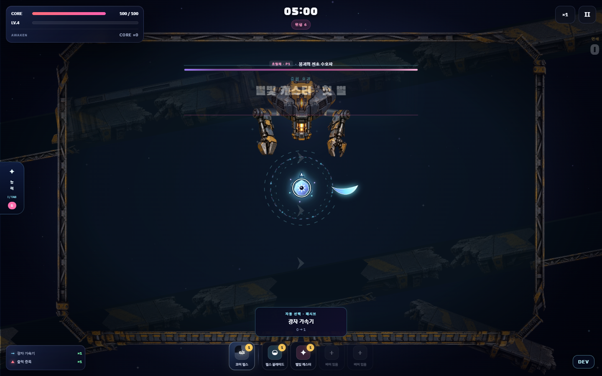
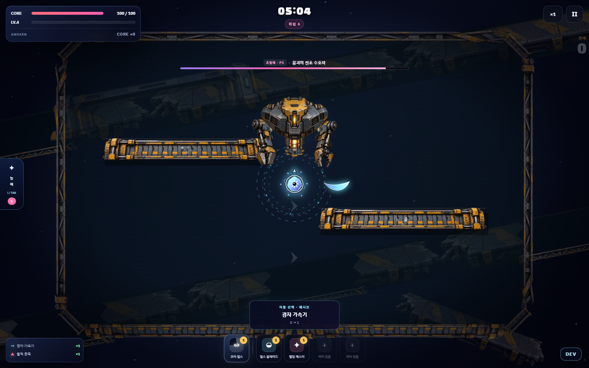
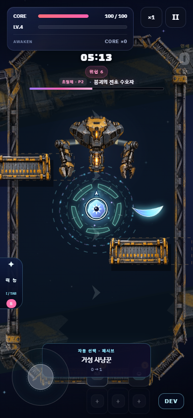
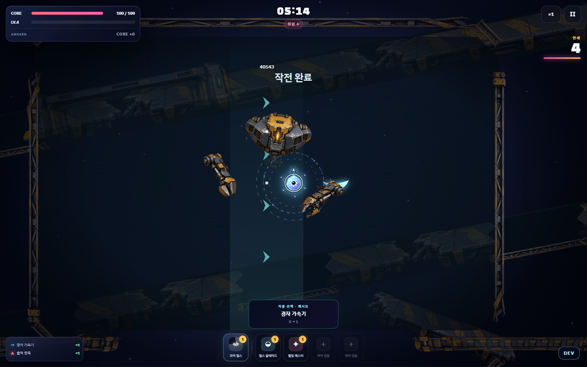

# Stage 1 production vertical slice · 2026-10-09

Stage 1만 제작했다. Stage 2~18 production redesign은 사용자 실플레이 승인 전 시작하지 않는다. 변경 전 remote main을 직접 조회하고 `66ff6b6ce64e27b6dbb46c2c6548f726ccc5933a`까지 fast-forward한 뒤 기존 게임을 브라우저에서 관찰했다. 이후 4개 게임의 실제 시각 자료를 조사하고 Production Bible을 먼저 작성했다. main 직접 작업이며 branch/PR/파일 삭제는 없다.

Build fingerprint: `sha256-02d4015cae236122af4111eeb340529f3f9317568b3c23d32a20ab49802b67c3`. 최종 main commit과 hosted CI 결과는 인계 응답 및 GitHub에서 확인한다. 이 문서 자체에 자기 commit SHA를 넣어 순환 변경을 만들지 않는다.

## 조사와 적용

[Production Bible](STACKFALL_PRODUCTION_BIBLE.md)에 Visual / Motion / Boss Pattern / Stage Gimmick을 분리했다. [Undertale](https://undertale.com/about/)의 캐릭터와 공격 규칙 연결, [Cuphead](https://studiomdhr.com/press-kits/)의 큰 색면과 배경 분리, [Furi](https://www.thegamebakers.com/furi/)의 조용한 전장과 공격 리듬, [Hades](https://www.supergiantgames.com/games/hades/)의 실체 있는 구조물과 위치 선택을 Stackfall에 재해석했다. 스크린샷은 구도 근거이며 프레임 단위 모션 측정으로 주장하지 않는다. 외부 캐릭터·공격·에셋을 게임에 복제하지 않았다.

## 최종 공간과 수호자

월드 고정 두 대형 항로와 검문소, 희소한 찢어진 지지대가 여백을 만든다. 원경 관문만 약한 parallax를 쓴다. 작은 보스 미리보기와 근경 추종 장식을 제거했다. 45초부터 항로 갑판이 분리되어 중앙 쪽에 가속 이동하고 4.2초 실물 장애물로 남는다. 부모 항로의 단면도 바뀌며, 움직인 플레이어를 따라오지 않는다. 후반에는 두 조각으로 우회 공간을 바꾼다. 같은 갑판·격벽·지지대를 보스가 재사용한다.

Collapse Warden은 고장 난 검역 인양 기계다. 쐐기 흉부의 티타늄/마모 도장, 황토 장갑, 유압 실린더, 내부 황색 반응로가 큰 덩어리→중간 구조→표면 디테일 순으로 읽힌다. 원본 래스터 4개와 음영 연결부 2개가 하나의 관절 기계를 만든다. 무기/접촉은 동일 pose의 실제 다각형 6개를 사용하고 아래 중앙 틈은 비어 있다. visual110 / weapon broad-phase155 / contact65의 구분, swept 검사는 보존한다. 몸체가 체력바를 가리던 초기 배치를 수정했다.

| 주요 행동 | 플레이어 판단 | 준비·발동·후속 동작 |
| --- | --- | --- |
| 인양 잔해 | 고정된 착지점을 벗어나고 남은 잔해 사이로 경로를 선택 | 인양 팔 상승→0.9초부터 시간차 세 번 사출→가속 착지→2.05초 잔류→팔 회복 |
| 격벽 교환 | 두 판 사이 연결 통로를 확보하고 2페이즈에서는 이동하는 출구를 따라가기 | 양팔 수축→1.05초 경고→0.48초 cubic 폐쇄→충격·유지→0.45초 후퇴. 이동 목적지도 별도 안내 |
| 본체 돌파 | 방향을 유도한 뒤 옆으로 피하고 제동 구간에 접근 | 반대 하중 이동→1.15초 방향 고정→0.72초 가속·감속→짧은 반동→회복 |
| 거더 회수 | 경첩 안쪽 또는 지지대 바깥쪽 선택 | 파손 팔 준비→0.95초 예고→0.75초 실물 회전→잔류와 복귀 |

보스의 평상시 이동은 하역장 양쪽 레일 앵커를 교대하는 dt 기반 관성 이동이다. 발사 방향을 잠근 뒤 플레이어를 계속 따라가지 않는다. 48%에서 낡은 공격 예약을 취소하고 0.9초 동안 외장과 팔을 벌려 반응로를 노출하며 하역장이 15% 확장된다. 작은 페이즈 알림으로 몸체를 비운다. 격파는 반응로 소등→연결 해제→팔 탈락→하단 봉쇄문 후퇴→열린 출구를 3.4초 보여 준 뒤 기존 승리 소유자가 보상을 기록한다.

화면 전체 flash를 추가하지 않았다. 중요 접촉에 35~45ms hit-stop, 부품 반동, 적은 파편, 거리에 따른 제한된 카메라 반응을 사용한다. 화면 흔들림 OFF를 존중한다. 기존 frontier / warden WebAudio 장면은 유지했다. 사용자 요청 후 실제 테스트 탭의 전체 소리를 OFF로 적용했으며 자동 브라우저는 `--mute-audio`로 실행한다. 새 BGM 작곡/믹스는 하지 않았다.

## 브라우저 증거와 수정

실제 UI에서 기존 시작 보상 3회를 선택하고 일반 전투·이동·조우를 관찰했다. DEV 4:55 버튼을 실제로 눌러 등장과 보스전을 확인했다. 별도 deterministic 브라우저 scene은 invincible / 레벨업 잠금 / 자동 시작 보상 선택 / HP seek를 사용한다. 이는 검증 fixture이고 게임 기본 설정이나 밸런스 변경이 아니다. 전체 자연 플레이의 난이도를 통과했다고 주장하지 않는다.

| 경로 / 해상도 | 기록한 장면 | 결과 |
| --- | --- | --- |
| GPU 1440×900 | 0/20/45/135/220/295초, 등장, P1, 5개 공격 fixture의 0.55/1.30/1.70/2.25/3.00초, 페이즈, 격파 초기·관문 개방 | 17 checks PASS |
| GPU 1280×720 | 동일 matrix, 작은 높이에서 몸체/HUD 확인 | 17 checks PASS |
| Canvas 1440×900 | 동일 matrix, GPU 없이 원본 재질·승리 출력 확인 | 17 checks PASS |
| Canvas 390×844 | 동일 matrix, 통로 이동·외장·컨트롤 영역 확인 | 17 checks PASS |

총 148 PNG를 `test-results/stage1-vertical-slice/`에 생성했다. 대표 장면과 JSON은 [증거 폴더](stage1-evidence/)에 보존한다. [추가 slice 결과](stage1-evidence/vertical-slice-results.json), [기존 shared browser 결과](stage1-evidence/shared-browser-results.json)는 코드 체크와 실제 런타임 관측을 구분한다.

직접 확인하고 수정한 문제: 팔이 분리 장식처럼 보임→음영 유압 연결부; 검은 직사각형 항로 틈→찢어진 단면; 보스/HUD 중첩→새 진입 높이와 외장 bounds 제한; 모바일 큰 페이즈 배너→작은 전용 알림; 경고 중 떠 있던 갑판→부착 상태 유지 후 실제 이동; 초반 screenshot이 시작 선택창에 가림→기존 자동 선택 옵션을 쓰고 선택창이 있으면 fixture 실패. 관련 기존 UI·후속 Stage 디자인은 별도 범위로 보존한다.

## 계약과 성능

`node scripts/build-fingerprint.mjs` 전체 Validate PASS: src JS 69개 syntax, 42개 계약 suite와 ownership 8개 그룹, 766개 PASS 출력. Stage 1 / 실제 Stage geometry / Stage craft / DEV / Stage balance-performance / performance audit / Stage map / 진행·보상·ownership을 포함한다. 새 `stage1-art-contract.mjs`는 실제 제작 pose 함수를 읽어 회전·관절 무기 판정, 중앙 빈 틈, 코어 노출과 자산 예산을 검증하며 Validate와 CI에 추가했다. 구 silhouette source token만 검사하던 계약은 실제 래스터+관절 다각형을 확인하도록 정본과 함께 갱신했다.

기존 shared browser의 desktop GPU / desktop Canvas / mobile Canvas도 PASS: 정확한 300초 진입, 4:55 clean seek, outer arm의 초고속 실제 탄환 판정, x2 고정 simulation, 네 공격 실행, 좌표 점프 방지, 최대 물체 6개, 구조 페이즈, 실제 boss damage→승리→결과, 단일 승리 foreground, runtime/resource errors 0. 추가 fixture는 세계 고정 incident, 실제 움직이는 구조물의 피해와 밀림, 관절 변화, 모바일 bounds를 확인한다.

첫 hosted live smoke는 Stage 3~18 world anchor 검사 16개에서 실패했다. 기존 검사 wrapper가 `StageCraft.worldPoint`에 남아 있던 세 번째 인자를 parallax 배율로 간주했지만, 실제 구현은 두 인자로 월드 좌표를 그대로 투영한다. wrapper를 실제 full-world 투영에 맞췄으며 해당 Stage runtime은 수정하지 않았다. 수정 후 전체 local live smoke는 PASS: GPU/context 복구 3회, 차단된 Pixi의 의도된 Canvas fallback, 18개 Stage의 이동 기준점과 정상 보스 진입, awakening isolation을 확인했다. 의도적으로 차단한 CDN 경고/요청 실패는 허용된 fallback 증거이며 실제 오류와 구분한다. [전체 smoke 결과](stage1-evidence/full-smoke-results.json)를 보존한다.

원본 자산 8개: 568,608바이트 WebP / 5,404,772바이트 decoded RGBA. 자산은 한 번만 로드하고 주변 구조만 그리며 텍스처를 프레임마다 만들지 않는다. 원본 생성 지시와 crop manifest는 [assets/stage1](../assets/stage1/README.md)에 기록했다. 90회 draw 호출의 CPU 제출 p95는 마지막 측정에서 GPU desktop 0.4ms / small 0.4ms / Canvas desktop 0.5ms / mobile 0.6ms였다. 이것은 FPS·GPU 완료 시간·실제 휴대폰 장기 성능 측정이 아니다.

## 사용자 실플레이 평가

확인된 runtime/resource/계약 실패는 없다. 남은 품질 판단은 실제 조작감, 경고 가독성과 난이도이며 저사양 실제 휴대폰 장기 FPS도 미측정이다. DEV 무적을 끄고 일반 출격으로 다음을 봐 달라.

1. 45초 항로판이 배경에서 떨어지는 물체로 읽히고, 남은 장애물을 돌아가는 선택이 자연스러운가.
2. 잔해를 벗어나기·통로 따라가기·돌진 옆으로 피하기·경첩 안쪽/바깥쪽 선택이 서로 다른 행동으로 느껴지는가.
3. 준비·가속·충격·반동·회복을 읽을 수 있고 공격 사이 여유가 적절한가.
4. 작은 화면에서 실루엣과 위험 물체가 명확하며 48% 개방과 처치 후 출구가 구조 변화로 읽히는가.

이 단계에서 멈춘다. 사용자 승인 전 Stage 2로 넘어가지 않는다.
